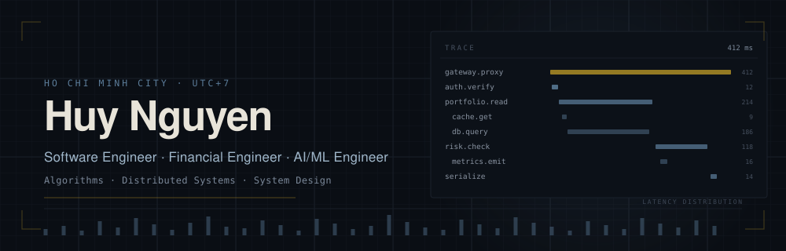
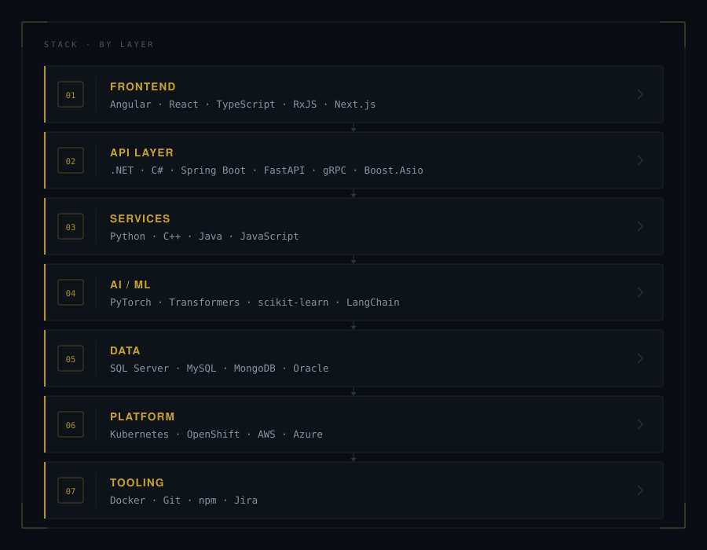

<div align="center">



<br />


</div>


```console
huy312100@kernel:~$ whoami
Huy Nguyen :: Software Engineer :: Ho Chi Minh City, VN

huy312100@kernel:~$ cat /etc/domain
banking · enterprise financial systems

huy312100@kernel:~$ ls ~/offline
books/  movies/  games/

huy312100@kernel:~$ echo $WEB
https://huy312100.netlify.app/
```

`▸ EDUCATION` &nbsp;·&nbsp; Information Technology · University of Science, Vietnam National University HCMC (VNU-HCMUS)


`▸ SHIPPING` &nbsp;·&nbsp; core banking platform

`▸ RUNNING` &nbsp;·&nbsp; containerised delivery on Kubernetes and OpenShift, deployed to AWS

`▸ DIGGING` &nbsp;·&nbsp; low-latency C++ cores and Python-side quantitative research


<p align="center">
  
</p>


<p align="center">
  
</p>

<p align="center">
  
  
</p>

<p align="center">
  
  
</p>

<p align="center">
  
</p>

<p align="center">
  <a href="https://app.daily.dev/huy312100"></a>
</p>


<p align="center">
  
</p>


<p align="center">
  <a href="https://github.com/huy312100"></a>
  <a href="https://www.linkedin.com/in/huynguyen2103/"></a>
  <a href="mailto:huy312100@gmail.com"></a>
  <a href="https://www.facebook.com/huy312100/"></a>
  <a href="https://www.instagram.com/huy312100/"></a>
</p>

<p align="center">
  <a href="https://leetcode.com/huy312100/"></a>
  <a href="https://www.hackerrank.com/huy312100?hr_r=1"></a>
  <a href="https://codeforces.com/profile/huy312100"></a>
  <a href="https://atcoder.jp/users/huy312100"></a>
  <a href="https://www.codechef.com/users/huy312100"></a>
</p>
